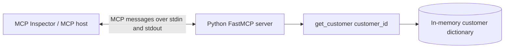

# Part 6: Build Your First MCP Server Using Python

This example is a local, in-memory Customer Management MCP server. It exposes exactly one tool, `get_customer(customer_id: int)`, through stdio. It does not include an AI application, database, REST API, or authentication.

## What is MCP?

The Model Context Protocol (MCP) is an open standard that lets AI applications connect to external tools and data through a consistent interface. An MCP server describes what it offers, and an MCP host can discover and call those capabilities.

A tool is an action the host can ask a server to run. Here, the action looks up a customer record.

## What are we building, and why use MCP?

We are building the smallest useful example: a Python process with three in-memory customers and one read-only lookup tool. MCP allows compatible clients to discover and call the tool without each client needing a custom integration for this Python function.

| ID | Name | Email | City |
| --- | --- | --- | --- |
| 101 | John | john@example.com | Hyderabad |
| 102 | Sarah | sarah@example.com | Bangalore |
| 103 | David | david@example.com | Chennai |

## Architecture



With stdio, the host starts the server as a child process. Standard input and output carry MCP messages; there is no HTTP port.

## What is FastMCP?

`FastMCP` is the high-level server API in the official MCP Python SDK v1.x. The `@mcp.tool()` decorator registers a typed Python function as an MCP tool. The SDK uses the function signature and docstring to describe the tool, and it handles the protocol exchange.

This project intentionally pins the SDK below version 2 because v2 renamed the server class. The official SDK's v1.x maintenance documentation recommends an upper bound below 2 for existing FastMCP code. See the [official v1.x SDK README](https://github.com/modelcontextprotocol/python-sdk/blob/v1.x/README.md) and [SDK documentation](https://py.sdk.modelcontextprotocol.io/v1/).

## How `get_customer` works

The function accepts an integer customer ID and returns a dictionary with name, email, and city. It checks for positive integer input, finds the record in `CUSTOMERS`, and raises a clear `ValueError` if there is no match. The SDK reports that exception as a tool error to the caller.

The separate `find_customer` function contains the lookup logic so it can be tested directly. `get_customer` is the only decorated tool.

## Install on Windows

Open PowerShell. Install `uv` if it is not installed:

```powershell
winget install --id astral-sh.uv -e
```

Close and reopen PowerShell after installation. Install Python 3.12 through uv:

```powershell
uv python install 3.12
```

Clone this repository, then enter the Part 6 folder. If you already have the repository locally:

```powershell
Set-Location C:\Work\Projects\mcp-developers-series\part-06-first-mcp-server
```

Create the virtual environment and install the project and development dependencies:

```powershell
uv sync --all-groups
```

Confirm the Python version and installed SDK:

```powershell
uv run python --version
uv run python -c "from importlib.metadata import version; print(version('mcp'))"
```

`pyproject.toml` requires Python 3.12 and an official `mcp[cli]` v1 release (`>=1.28,<2`). The CLI extra includes the `mcp` development command used by Inspector.

## Start the MCP server

From the Part 6 directory:

```powershell
uv run python server.py
```

The server waits for a compatible MCP client. That is expected: stdio is the protocol connection, so the server does not print a web address or a startup banner. Press Ctrl+C to stop it when you started it directly.

## Connect with MCP Inspector

The MCP Inspector is a separate testing UI. The SDK's development command starts the server process and Inspector together. Run from the Part 6 directory:

```powershell
uv run mcp dev server.py
```

When the Inspector opens, connect to the server if it has not connected automatically. Open **Tools**, select `get_customer`, enter a customer ID, and run it. The Inspector UI communicates with its proxy, which launches `server.py` over stdio.

To launch Inspector directly instead, run this in another PowerShell window:

```powershell
npx -y @modelcontextprotocol/inspector
```

Then configure the Inspector to launch the server with command `uv` and arguments `run --directory C:\Work\Projects\mcp-developers-series\part-06-first-mcp-server python server.py`. The `mcp dev` command is the simpler option for this project.

## Example tool invocation

Select `get_customer` and enter:

```json
{
  "customer_id": 101
}
```

Expected result:

```json
{
  "name": "John",
  "email": "john@example.com",
  "city": "Hyderabad"
}
```

ID `102` returns Sarah in Bangalore. ID `999` returns a tool error with a message similar to:

```text
Customer with ID 999 was not found.
```

## Run the unit tests

```powershell
uv run pytest
```

The tests cover successful lookups, an unknown ID, and non-positive IDs.

## Troubleshooting

- **`uv` is not recognized:** finish the installation, reopen PowerShell, and run `uv --version`.
- **Wrong Python version:** run `uv python install 3.12`, then `uv sync --all-groups`; check with `uv run python --version`.
- **Dependency/API errors:** this example requires MCP SDK v1.x. Check that `uv run python -c "from importlib.metadata import version; print(version('mcp'))"` prints a version below `2`.
- **Inspector cannot start:** confirm Node.js/npm is available (`node --version`, `npx --version`), then retry `uv run mcp dev server.py`.
- **The server appears to do nothing:** this is normal for stdio. Start it through Inspector or another MCP host so a client can connect.
- **Import error for `mcp`:** run `uv sync --all-groups` from this directory.

## Project files

- `server.py` defines the sample data, lookup logic, one MCP tool, and stdio startup.
- `tests/test_server.py` has basic lookup and input validation tests.
- `pyproject.toml` declares Python and dependency requirements.


