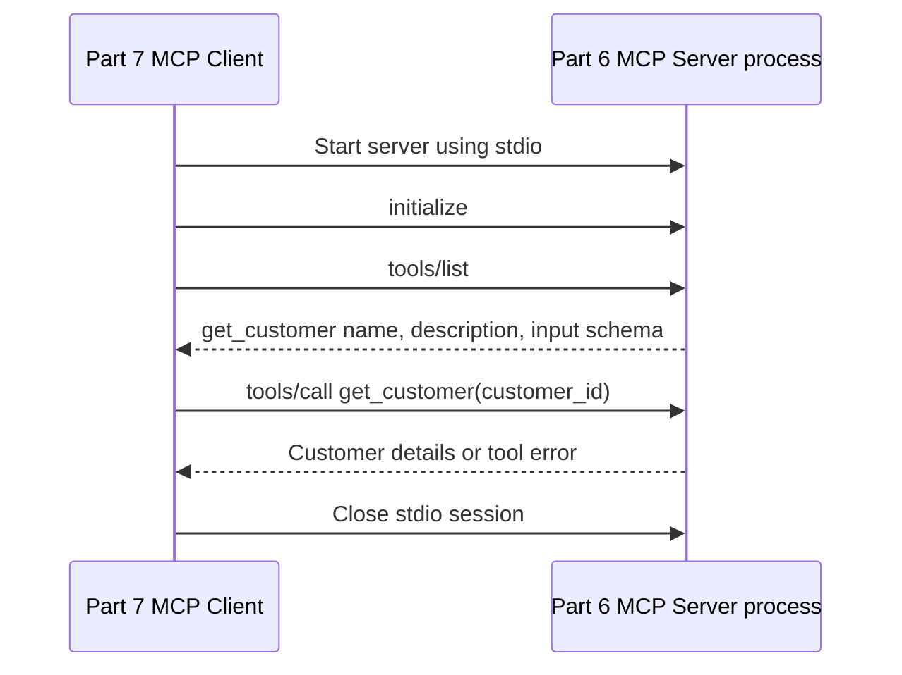

# Part 7: Build Your First MCP Client Using Python

This learning example is a standalone Python MCP client that launches the existing [Part 6 customer server](../part-06-first-mcp-server/README.md) over stdio. It uses the official MCP Python SDK v1.x client API and does not reimplement or import the server's Python functions.

## Prerequisites

- Python 3.12
- [uv](https://docs.astral.sh/uv/)
- Part 6 present at `../part-06-first-mcp-server`

The SDK dependency stays on the same v1.x line as Part 6 (`mcp>=1.28,<2`). This avoids the v2 API transition and keeps this client compatible with the current server implementation.

The implementation follows the official [v1.x client documentation](https://py.sdk.modelcontextprotocol.io/v1/client/) and the [v1.x SDK maintenance guidance](https://github.com/modelcontextprotocol/python-sdk/tree/v1.x).

## Install

From the repository root in PowerShell:

```powershell
Set-Location C:\Work\Projects\mcp-developers-series\part-07-first-mcp-client
uv sync --all-groups
```

## Run the client

The default customer ID is `101` (John):

```powershell
uv run python client.py
```

Pass a different ID as a positional argument. For example, Sarah is `102` and unknown ID `999` demonstrates the server's tool error:

```powershell
uv run python client.py 102
uv run python client.py 999
```

A non-integer or non-positive customer ID is rejected with a clear command-line error. The client prints every discovered tool name and description before calling `get_customer`.

## Example output: successful lookup

```text
Available MCP tools:
- get_customer: Look up a customer by ID and return their name, email, and city.

Calling get_customer(customer_id=101)...
Customer details:
{
  "name": "John",
  "email": "john@example.com",
  "city": "Hyderabad"
}
```

## Example output: unknown customer

```text
Calling get_customer(customer_id=999)...
Tool error: Error executing tool get_customer: Customer with ID 999 was not found.
```

## What happens in the protocol



`stdio_client` starts the existing Part 6 process, and `ClientSession` performs MCP operations over the process's stdin/stdout streams. Exiting the nested async context managers closes the session and child process.

## Host, Client, and Server

- **MCP Host:** the user-facing application that owns the overall experience and may use models, interface, and one or more clients. Part 7 is not a full MCP Host application.
- **MCP Client:** the protocol component that establishes a session with a server, discovers capabilities, and sends tool calls. This part is a simple standalone MCP Client for learning.
- **MCP Server:** the program that exposes tools or other capabilities over MCP. Part 6 provides `get_customer` and the in-memory customer records.

This client has no LLM. It sends the customer ID directly from its command line and prints the server's response.

## Tests

Run the Part 7 integration and input validation tests from this folder:

```powershell
uv run pytest
```

The integration tests launch the actual Part 6 server over stdio, verify discovery and lookups for IDs 101, 102, and 999, and rely on context-managed cleanup after each interaction.

