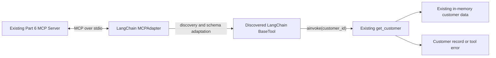

# Part 8: Integrate MCP with LangChain

This example connects LangChain to the existing [Part 6 customer MCP server](../part-06-first-mcp-server/README.md). It discovers `get_customer(customer_id: int)`, adapts its advertised schema into a LangChain tool, calls IDs 101 and 102, and handles unknown ID 999. No LLM or agent is used.

## Architecture



- **Part 6 server** owns the customer data and lookup logic.
- **MCP over stdio** carries tool discovery and calls between separate processes.
- **MCPAdapter** uses FastMCP client support to negotiate the connection, discover tools, and adapt their MCP schemas to asynchronous LangChain `BaseTool` objects.
- **Discovered tool** is printed with its server-provided description and integer argument schema, then invoked using `ainvoke`.
- **Result** comes from the existing Part 6 function. Part 8 defines no replacement tool or customer data.

## API and dependency compatibility

The [current official LangChain MCP docs](https://docs.langchain.com/oss/python/langchain/mcp) document `langchain.mcp.MCPAdapter`, the `langchain[mcp]>=1.4.0` extra, `await adapter.list_tools()`, and local stdio targets. The API is in beta. This app invokes a returned tool with `await tool.ainvoke({"customer_id": 101})`.

The existing Parts 6 and 7 intentionally pin the official MCP SDK to `mcp>=1.28,<2` (currently locked to 1.30.0). Current `langchain[mcp]` depends on FastMCP 4, which requires `mcp>=2.0`; those ranges cannot coexist in one Python environment. We keep Parts 6 and 7 unchanged and isolate Part 8's environment. Its stdio transport launches the existing Part 6 server with `uv run --directory ..\part-06-first-mcp-server`, so that server continues to use its own MCP SDK 1.x environment. The FastMCP client is configured for the legacy MCP initialize/list-tools protocol used by Part 6. Integration tests verify this arrangement.

Part 8 declares `langchain[mcp]>=1.4.0,<2`; the exact LangChain, FastMCP, and MCP 2.x versions are recorded in `uv.lock`. Do not install Part 8 dependencies into the Part 6 or Part 7 environment.

## Install and run on Windows

Prerequisites: Python 3.12 and [uv](https://docs.astral.sh/uv/). In PowerShell:

```powershell
Set-Location C:\Work\Projects\mcp-developers-series\part-08-langchain-mcp-integration
uv sync --all-groups
uv run python app.py
```

The adapter starts the existing server over stdio using the Part 6 project's own locked environment. Run tests with `uv run pytest`.

## Sample output

```text
Available LangChain tools adapted from MCP:
- get_customer(customer_id: integer): Look up a customer by ID and return their name, email, and city.

Invoking discovered get_customer with customer_id=101...
Customer 101:
{
  "name": "John",
  "email": "john@example.com",
  "city": "Hyderabad"
}

Invoking discovered get_customer with customer_id=102...
Customer 102:
{
  "name": "Sarah",
  "email": "sarah@example.com",
  "city": "Bangalore"
}

Invoking discovered get_customer with customer_id=999...
Customer lookup error: Customer with ID 999 was not found.
```

## What happens

1. `create_mcp_client()` configures FastMCP's documented stdio transport to run `uv` in the Part 6 directory. That preserves the server's existing Python environment.
2. `MCPAdapter(client)` manages that MCP client; `async with` provides lifecycle cleanup.
3. `await adapter.list_tools()` discovers the advertised tool name, description, and input schema.
4. MCPAdapter turns the server schema into a LangChain tool automatically; `args_schema` lets the example display the discovered integer argument.
5. `await tool.ainvoke({"customer_id": 101})` sends the call to the original Part 6 Python implementation.
6. The direct invocation returns the MCP error as tool content (prefixed with `Error executing tool`). The app recognizes and displays the server message. It also catches `ToolException` should one be raised by the installed adapter.
7. Exiting the adapter context closes the session and stdio process.

```text
Existing Python MCP Server -> MCP protocol over stdio -> LangChain MCPAdapter
  -> automatically adapted LangChain tool -> existing get_customer -> result
```

Part 8 focuses on discovery and direct invocation only. It adds no LangGraph, AI agent, LLM, database, REST API, authentication, or deployment.
