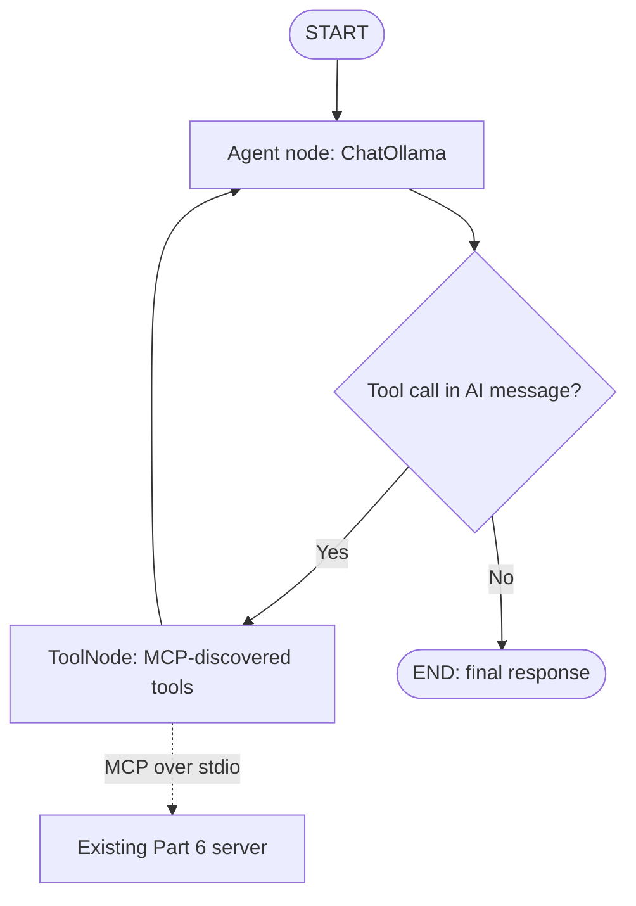

# Part 9: Build an MCP-Powered AI Agent Using LangGraph

This part adds a local customer assistant that lets an LLM decide whether to
call the existing Part 6 `get_customer` MCP tool. It reuses Part 8's stdio
transport and current LangChain MCPAdapter integration. The server and its
business logic remain unchanged.

## LangChain and LangGraph

LangChain supplies integrations for chat models and tools. Its MCPAdapter
discovers server tools and converts them to LangChain tools. LangGraph is a
workflow orchestration runtime: it makes the agent state and the path between
model and tool steps explicit. The graph here is intentionally small, with one
agent node, one tool node, and a conditional edge.

The graph uses `MessagesState` to hold the conversation messages, including the
user request, model tool call, tool result, and final answer. The `agent` node
calls `ChatOllama` asynchronously with the MCP-discovered tools bound. The
model's normal structured tool-calling response determines whether a tool is
needed. `tools_condition` sends requests with tool calls to the `tools` node;
otherwise it routes to `END`. `ToolNode` executes the selected MCP-backed
LangChain tool and appends its result. An edge returns to the agent node so the
LLM can use that result to write a natural-language response. `START` begins
the graph, and `END` finishes it.



The system prompt explains when lookup is appropriate, while the application
does not parse customer IDs or hardcode tool calls. Qwen chooses and fills the
tool call through LangChain's `bind_tools()` mechanism. The agent is limited to
the one tool currently exposed by Part 6.

## Why the existing Parts use separate environments

Part 6 and Part 7 use MCP SDK 1.x. Current `langchain[mcp]` uses FastMCP 4 and
MCP 2.x. Combining them in one environment would violate their dependency
ranges. Part 8 already handles this by running the Part 6 server with `uv run`
in its own project directory and connecting through FastMCP's legacy stdio
client. Part 9 imports and reuses Part 8's `create_mcp_client()` rather than
reimplementing that connection or server behavior.

## Prerequisites and install (Windows PowerShell)

Install Python 3.12 and `uv` as described in the root README. Install Ollama and
start its local service. From this folder, sync the isolated Part 9 environment:

```powershell
Set-Location C:\Work\Projects\mcp-developers-series\part-09-langgraph-mcp-agent
uv sync --all-groups
ollama pull qwen3:4b
```

`qwen3:4b` is the default model. The model is local; this example does not use
a paid cloud API. To use another already-installed model explicitly, pass
`--model <tag>`.

## Run

Interactive mode:

```powershell
uv run python agent.py --show-tool-calls
```

Single request:

```powershell
uv run python agent.py --message "Get customer 101 details" --show-tool-calls
uv run python agent.py --message "Find customer 102" --show-tool-calls
uv run python agent.py --message "Do we have a customer with ID 999?" --show-tool-calls
uv run python agent.py --message "What can you help me with?" --show-tool-calls
```

`--show-tool-calls` prints the calls selected by the LLM to stderr so you can
confirm when it used `get_customer`. Expected Part 6 fixture data: customer 101
is John in Hyderabad; 102 is Sarah in Bangalore; 999 is not found. General
questions should finish without a tool call. Exact wording depends on the
model.

## Error handling and cleanup

Part 9 verifies that the discovered server tools include `get_customer` before
building the graph. Model, tool, and connection exceptions are surfaced as a
readable message. The adapter is managed with `async with`; leaving that scope
closes the MCP session and stdio subprocess, including after a single-message
request or an exception.

## Tests

Run graph routing tests without Ollama:

```powershell
uv run pytest
```

These tests verify that lookups for 101 and 102 run and their results return to
the LLM, a general question ends without executing a tool, and the unknown-ID
result reaches the LLM. Part 8's integration suite verifies the reused MCP
transport and its cleanup; run it from its own folder with `uv run pytest`.

## APIs and model compatibility

- LangGraph: `StateGraph`, `MessagesState`, `START`, `END`, `ToolNode`, and
  `tools_condition` are the explicit graph workflow APIs.
- LangChain MCP: `MCPAdapter`, `await adapter.list_tools()`, and MCP-backed
  `BaseTool` objects are used by Part 8 and passed to the graph.
- LangChain model tools: `ChatOllama.bind_tools()` exposes tool schemas to the
  model, whose structured tool call selects the name and arguments.
- Async behavior: graph model nodes use `await ...ainvoke(...)`; the adapter
  discovers tools asynchronously; `graph.ainvoke(...)` drives the workflow.
- Dependencies: `langchain[mcp]>=1.4.0,<2`, `langchain-ollama>=1.0.0,<2`, and
  `langgraph>=1.0.0,<2`, isolated from Parts 6–8.
- Resolved during verification: LangChain 1.5.2, LangGraph 1.2.24,
  `langchain-ollama` 1.2.0, FastMCP 4.2.6, and MCP 2.3.0. The exact
  environment is recorded in this folder's `uv.lock`.

The current Ollama model library labels Qwen3 as supporting tools and lists the
4B model variant. In this environment, `qwen3:4b` was pulled and exercised
through the LangChain/LangGraph integration with the existing Part 6 server.

## Verification status

Verification completed on 2026-11-25 (Asia/Kolkata): the live Qwen3 flow looked
up IDs 101 and 102, reported unknown ID 999 from the tool result, and answered
a general question without a tool call. The 101 and 102 answers used the
returned customer records. The single-request and interactive sessions exited
cleanly through the adapter context. Automated graph tests passed (4); the
existing Part 6, 7, and 8 suites also passed (5, 5, and 3 tests). Part 9 is
complete; see the roadmap.

## Official references

- [LangGraph overview](https://docs.langchain.com/oss/python/langgraph/overview)
- [LangChain tools](https://docs.langchain.com/oss/python/langchain/tools)
- [LangChain MCP integration](https://docs.langchain.com/oss/python/langchain/mcp)
- [ChatOllama integration](https://docs.langchain.com/oss/python/integrations/chat/ollama)
- [Ollama Qwen3 model library](https://ollama.com/library/qwen3)
